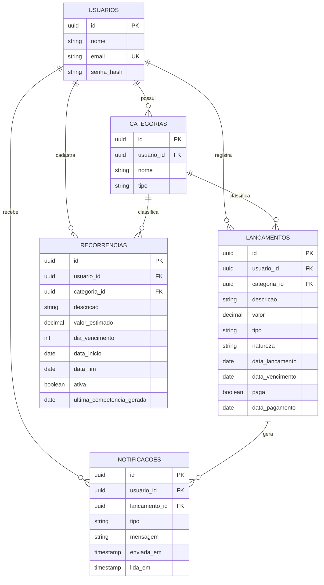

# FinanceFlow

Painel de controle financeiro pessoal com lançamentos, categorias, contas a vencer e alertas agendados.

## Stack

- **API:** Java 21, Spring Boot 4.0.9, Spring Security com JWT, Spring Data JPA, PostgreSQL, Flyway
- **Web:** Angular 21 (standalone, zoneless, signals), TypeScript, SCSS, Vitest
- **Infra local:** Docker Compose

## Estrutura

```
financeflow/
├── api/                 API REST em Spring Boot
├── web/                 SPA em Angular
└── docker-compose.yml
```

## Como rodar localmente

### Pré-requisitos

- Java 21
- Node.js compatível com o Angular 21 (o projeto foi desenvolvido com a versão 24.x) e npm
- Docker

### Banco de dados

```bash
docker compose up -d
```

### API

```bash
cd api
./mvnw spring-boot:run
```

A API sobe em `http://localhost:8080`. O health check fica em `/actuator/health`.

### Web

```bash
cd web
npm install
npm start
```

A aplicação sobe em `http://localhost:4200` e encaminha as chamadas `/api` para a API em `http://localhost:8080` (veja `web/proxy.conf.json`). Suba a API antes de usar.

## Testes

```bash
cd api
./mvnw verify
```

Os testes de persistência e de integração sobem um PostgreSQL real via Testcontainers, então o Docker precisa estar ativo.

```bash
cd web
npm test -- --watch=false
npm run build
```

## Modelo de dados



## Arquitetura da API

Organização por funcionalidade, com regras de negócio dentro das entidades e o banco como segunda linha de defesa (constraints, índices e chaves estrangeiras versionados com Flyway).

```
api/src/main/java/br/com/nevvesdev/financeflow/
├── compartilhado/   exceções, validações, relógio e tratamento global de erros
├── seguranca/       JWT, CORS e configuração stateless
├── usuario/         entidade e repositório de usuários
├── autenticacao/    cadastro, login e perfil
├── categoria/       categorias por usuário
├── lancamento/      lançamentos, filtros dinâmicos e pagamento
├── painel/          agregações do painel
├── recorrencia/     contas fixas e geração agendada
└── notificacao/     avisos de vencimento e canais de entrega
```

## Testes

```bash
cd api
./mvnw verify
```

Os testes de persistência sobem um PostgreSQL real via Testcontainers, então o Docker precisa estar ativo.

## Autenticação

A API usa JWT (HS256) em modo stateless.

| Método | Rota | Acesso | Descrição |
|---|---|---|---|
| POST | `/api/auth/cadastro` | público | Cria um usuário |
| POST | `/api/auth/login` | público | Retorna o token de acesso |
| GET | `/api/auth/eu` | autenticado | Retorna o perfil do usuário do token |
| GET | `/actuator/health` | público | Health check |

Enviar o token no header `Authorization: Bearer <token>`.

### Variáveis de ambiente

| Variável | Padrão | Descrição |
|---|---|---|
| `DB_URL` | `jdbc:postgresql://localhost:5432/financeflow` | URL do banco |
| `DB_USERNAME` | `financeflow` | Usuário do banco |
| `DB_PASSWORD` | `financeflow` | Senha do banco |
| `JWT_SEGREDO` | valor de desenvolvimento | Segredo do JWT, mínimo de 32 caracteres |
| `JWT_EXPIRACAO` | `2h` | Validade do token |
| `CORS_ORIGENS` | `http://localhost:4200` | Origens permitidas, separadas por vírgula |
| `FUSO_HORARIO` | `America/Sao_Paulo` | Fuso usado para calcular "hoje" e vencimentos |
| `AGENDAMENTO_HABILITADO` | `true` | Liga ou desliga os jobs agendados |
| `RECORRENCIAS_CRON` | `0 0 6 * * *` | Horário do job de geração de recorrências (no fuso configurado) |
| `NOTIFICACOES_CRON` | `0 30 7 * * *` | Horário do job de avisos de vencimento (no fuso configurado) |

Em produção, sempre defina `JWT_SEGREDO` com um valor forte e exclusivo.

## Categorias

Cada usuário recebe categorias padrão no cadastro e pode gerenciar as próprias. O tipo (`RECEITA` ou `DESPESA`) não muda depois de criado, e nomes são únicos por usuário e tipo, ignorando maiúsculas e minúsculas.

| Método | Rota | Descrição |
|---|---|---|
| GET | `/api/categorias?tipo=` | Lista as categorias, com filtro opcional por tipo |
| POST | `/api/categorias` | Cria uma categoria |
| PUT | `/api/categorias/{id}` | Renomeia |
| DELETE | `/api/categorias/{id}` | Exclui, desde que não tenha lançamentos nem recorrências |

## Lançamentos

O tipo (`RECEITA` ou `DESPESA`) vem da categoria escolhida. A `natureza` diferencia contas fixas (`FIXA`: aluguel, internet) de gastos avulsos (`VARIAVEL`, o padrão).

| Método | Rota | Descrição |
|---|---|---|
| POST | `/api/lancamentos` | Cria um lançamento (pode já nascer pago) |
| GET | `/api/lancamentos` | Lista com filtros, paginação e ordenação |
| GET | `/api/lancamentos/{id}` | Busca um lançamento |
| PUT | `/api/lancamentos/{id}` | Atualiza |
| DELETE | `/api/lancamentos/{id}` | Exclui |
| POST | `/api/lancamentos/{id}/pagamento` | Marca como pago (data opcional, padrão hoje) |
| DELETE | `/api/lancamentos/{id}/pagamento` | Desfaz o pagamento |

### Filtros da listagem

| Parâmetro | Exemplo | Descrição |
|---|---|---|
| `inicio`, `fim` | `2026-10-01` | Período pela data do lançamento |
| `tipo` | `DESPESA` | Receita ou despesa |
| `natureza` | `FIXA` | Fixa ou variável |
| `categoriaId` | UUID | Uma categoria específica |
| `paga` | `true` | Pagos ou em aberto |
| `vencidos` | `true` | Em aberto com vencimento anterior a hoje |
| `busca` | `mercado` | Texto contido na descrição |
| `page`, `size` | `0`, `20` | Paginação (máximo de 100 por página) |
| `sort` | `valor,desc` | Ordenação por `dataLancamento`, `dataVencimento`, `valor`, `descricao` ou `criadoEm` |

## Painel

`GET /api/painel?mes=2026-10` devolve tudo o que a tela principal precisa em uma requisição. Sem `mes`, usa o mês atual.

| Bloco | Conteúdo |
|---|---|
| `previsto` | Entradas, saídas e saldo de todos os lançamentos do mês |
| `realizado` | Entradas, saídas e saldo apenas dos lançamentos pagos |
| `contasAVencer` | Despesas em aberto até hoje + 7 dias, atrasadas primeiro, com `vencido` e `diasParaVencer` |
| `gastosPorCategoria` | Despesas do mês por categoria, com total e percentual |
| `despesasPorNatureza` | Despesas do mês separadas em fixas e variáveis |

As somas são calculadas no banco, e a lista de contas a vencer traz no máximo 50 itens, com `quantidade` e `valorTotal` cobrindo todas.

## Contas fixas recorrentes

Cadastre aluguel, internet, luz ou um salário uma vez, e o sistema gera o lançamento de cada mês com o valor estimado. Quando a conta chega, basta ajustar o valor do lançamento.

| Método | Rota | Descrição |
|---|---|---|
| POST | `/api/recorrencias` | Cria e já gera o mês atual e o próximo |
| GET | `/api/recorrencias?ativa=` | Lista, com filtro opcional por status |
| GET | `/api/recorrencias/{id}` | Busca uma recorrência |
| PUT | `/api/recorrencias/{id}` | Atualiza (vale apenas para as próximas gerações) |
| POST | `/api/recorrencias/{id}/pausar` | Pausa a geração |
| POST | `/api/recorrencias/{id}/retomar` | Retoma sem gerar meses passados |
| DELETE | `/api/recorrencias/{id}` | Exclui, mantendo os lançamentos já gerados |

Regras de geração:

- Um job diário garante os lançamentos do mês atual e do próximo.
- Dia de vencimento 31 em meses curtos vira o último dia do mês.
- O job é idempotente: rodar duas vezes, ou em duas instâncias, não duplica lançamentos.
- Um lançamento excluído pelo usuário não é recriado.
- Os lançamentos gerados têm natureza `FIXA` e entram normalmente no painel e na lista de contas a vencer.

## Notificações

Um job diário avisa sobre despesas em aberto: três dias antes do vencimento, no dia e quando atrasam (até 30 dias). Cada conta gera no máximo um aviso de cada tipo, e rodar o job de novo não duplica nada.

| Método | Rota | Descrição |
|---|---|---|
| GET | `/api/notificacoes?naoLidas=` | Lista os avisos, mais recentes primeiro |
| GET | `/api/notificacoes/nao-lidas/total` | Total de avisos não lidos |
| POST | `/api/notificacoes/{id}/leitura` | Marca um aviso como lido |
| POST | `/api/notificacoes/leitura` | Marca todos como lidos |

Os avisos são entregues por canais plugáveis (`CanalDeNotificacao`). O canal atual escreve no log, sem o texto do aviso. Se um canal falhar, o aviso fica pendente e é reenviado na próxima execução. A entrega garante pelo menos uma vez, e o despacho assume uma única instância da API.

## Frontend

Angular 21 com componentes standalone, zoneless, signals e Vitest. Design system próprio em SCSS, sem biblioteca de UI.

```
web/src/
├── styles/        tokens, base, controles e cartão
└── app/
    ├── core/      autenticação, tema, interceptors, guards e utilitários de API
    ├── features/  telas por funcionalidade (autenticação, painel)
    ├── layout/    estrutura da área autenticada (menu lateral)
    └── shared/    componentes e utilitários reutilizáveis
```

### Telas

- **Painel:** saldo, entradas e saídas do mês (previsto e realizado), contas a vencer com as atrasadas em destaque e marcação de pagamento direto na lista, gastos por categoria e divisão entre despesas fixas e variáveis. Navegação por mês.
- **Lançamentos:** tabela com abas por tipo, seletor de período (atalhos e intervalo personalizado), filtros por busca, categoria, natureza e situação, ordenação por coluna, paginação, marcação e desfazer de pagamento e exclusão com confirmação.


### Design system

- **Tema:** escuro por padrão, claro opcional, alternado pelo botão do menu e lembrado no navegador. O atributo `data-tema` é definido antes do Angular carregar, para não piscar.
- **Tokens:** cores, raios, espaçamentos, tipografia e movimento ficam em variáveis CSS (`web/src/styles/_tokens.scss`), com variantes escura e clara. Há uma única cor de destaque (azul); verde e vermelho são usados apenas para receita e despesa.
- **Tipografia:** uma família do sistema, seis tamanhos e números tabulares, para valores alinharem em colunas.
- **Movimento:**
  - `--curva-padrao` (`cubic-bezier(0.2, 0, 0, 1)`): desaceleração suave para hover, foco e pressão.
  - `--curva-mola` (`cubic-bezier(0.34, 1.56, 0.64, 1)`): aproxima uma mola amortecida com leve overshoot, já que CSS não tem spring nativo. Usada na pílula deslizante do menu.
  - Com `prefers-reduced-motion`, as durações dos tokens viram zero e as animações são desligadas.
- **Acessibilidade:** foco visível, `aria-label` em botões de ícone, `aria-current` na navegação, mensagens de erro com `role="alert"` e controles utilizáveis por teclado.

### Comportamento

- O token JWT é anexado automaticamente às chamadas `/api/` (menos login e cadastro).
- Respostas 401 encerram a sessão e levam ao login, voltando à tela pedida depois de entrar.
- Erros de validação da API aparecem junto ao campo correspondente.

## Status

Em desenvolvimento.
