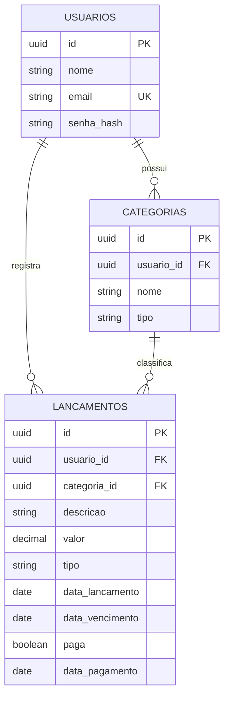

# FinanceFlow

Painel de controle financeiro pessoal com lançamentos, categorias, contas a vencer e alertas agendados.

## Stack

- **API:** Java 21, Spring Boot 4.0.9, Spring Security com JWT, Spring Data JPA, PostgreSQL, Flyway
- **Web:** Angular 21 (standalone), TypeScript, SCSS
- **Infra local:** Docker Compose

## Modelo de dados



## Testes

```bash
cd api
./mvnw verify
```

Os testes de persistência sobem um PostgreSQL real via Testcontainers, então o Docker precisa estar ativo.

## Autenticação

A API usa JWT (HS256) em modo stateless.

| Método | Rota | Acesso | Descrição |
|---|---|---|---|
| POST | `/api/auth/cadastro` | público | Cria um usuário |
| POST | `/api/auth/login` | público | Retorna o token de acesso |
| GET | `/api/auth/eu` | autenticado | Retorna o perfil do usuário do token |
| GET | `/actuator/health` | público | Health check |

Enviar o token no header `Authorization: Bearer <token>`.

### Variáveis de ambiente

| Variável | Padrão | Descrição |
|---|---|---|
| `DB_URL` | `jdbc:postgresql://localhost:5432/financeflow` | URL do banco |
| `DB_USERNAME` | `financeflow` | Usuário do banco |
| `DB_PASSWORD` | `financeflow` | Senha do banco |
| `JWT_SEGREDO` | valor de desenvolvimento | Segredo do JWT, mínimo de 32 caracteres |
| `JWT_EXPIRACAO` | `2h` | Validade do token |
| `CORS_ORIGENS` | `http://localhost:4200` | Origens permitidas, separadas por vírgula |
| `FUSO_HORARIO` | `America/Sao_Paulo` | Fuso usado para calcular "hoje" e vencimentos |

Em produção, sempre defina `JWT_SEGREDO` com um valor forte e exclusivo.

## Categorias

Cada usuário recebe categorias padrão no cadastro e pode gerenciar as próprias. O tipo (`RECEITA` ou `DESPESA`) não muda depois de criado, e nomes são únicos por usuário e tipo, ignorando maiúsculas e minúsculas.

| Método | Rota | Descrição |
|---|---|---|
| GET | `/api/categorias?tipo=` | Lista as categorias, com filtro opcional por tipo |
| POST | `/api/categorias` | Cria uma categoria |
| PUT | `/api/categorias/{id}` | Renomeia |
| DELETE | `/api/categorias/{id}` | Exclui, desde que não tenha lançamentos |

## Lançamentos

O tipo (`RECEITA` ou `DESPESA`) vem da categoria escolhida. A `natureza` diferencia contas fixas (`FIXA`: aluguel, internet) de gastos avulsos (`VARIAVEL`, o padrão).

| Método | Rota | Descrição |
|---|---|---|
| POST | `/api/lancamentos` | Cria um lançamento (pode já nascer pago) |
| GET | `/api/lancamentos` | Lista com filtros, paginação e ordenação |
| GET | `/api/lancamentos/{id}` | Busca um lançamento |
| PUT | `/api/lancamentos/{id}` | Atualiza |
| DELETE | `/api/lancamentos/{id}` | Exclui |
| POST | `/api/lancamentos/{id}/pagamento` | Marca como pago (data opcional, padrão hoje) |
| DELETE | `/api/lancamentos/{id}/pagamento` | Desfaz o pagamento |

### Filtros da listagem

| Parâmetro | Exemplo | Descrição |
|---|---|---|
| `inicio`, `fim` | `2026-10-01` | Período pela data do lançamento |
| `tipo` | `DESPESA` | Receita ou despesa |
| `natureza` | `FIXA` | Fixa ou variável |
| `categoriaId` | UUID | Uma categoria específica |
| `paga` | `true` | Pagos ou em aberto |
| `vencidos` | `true` | Em aberto com vencimento anterior a hoje |
| `busca` | `mercado` | Texto contido na descrição |
| `page`, `size` | `0`, `20` | Paginação (máximo de 100 por página) |
| `sort` | `valor,desc` | Ordenação por `dataLancamento`, `dataVencimento`, `valor`, `descricao` ou `criadoEm` |

## Status

Em desenvolvimento.
