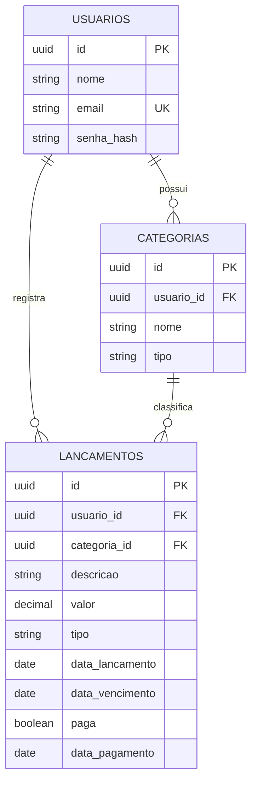

# FinanceFlow

Painel de controle financeiro pessoal com lançamentos, categorias, contas a vencer e alertas agendados.

## Stack

- **API:** Java 21, Spring Boot 4.0.9, Spring Security com JWT, Spring Data JPA, PostgreSQL, Flyway
- **Web:** Angular 21 (standalone), TypeScript, SCSS
- **Infra local:** Docker Compose

## Modelo de dados



## Testes

```bash
cd api
./mvnw verify
```

Os testes de persistência sobem um PostgreSQL real via Testcontainers, então o Docker precisa estar ativo.

## Autenticação

A API usa JWT (HS256) em modo stateless.

| Método | Rota | Acesso | Descrição |
|---|---|---|---|
| POST | `/api/auth/cadastro` | público | Cria um usuário |
| POST | `/api/auth/login` | público | Retorna o token de acesso |
| GET | `/api/auth/eu` | autenticado | Retorna o perfil do usuário do token |
| GET | `/actuator/health` | público | Health check |

Enviar o token no header `Authorization: Bearer <token>`.

### Variáveis de ambiente

| Variável | Padrão | Descrição |
|---|---|---|
| `DB_URL` | `jdbc:postgresql://localhost:5432/financeflow` | URL do banco |
| `DB_USERNAME` | `financeflow` | Usuário do banco |
| `DB_PASSWORD` | `financeflow` | Senha do banco |
| `JWT_SEGREDO` | valor de desenvolvimento | Segredo do JWT, mínimo de 32 caracteres |
| `JWT_EXPIRACAO` | `2h` | Validade do token |
| `CORS_ORIGENS` | `http://localhost:4200` | Origens permitidas, separadas por vírgula |

Em produção, sempre defina `JWT_SEGREDO` com um valor forte e exclusivo.

## Status

Em desenvolvimento.
