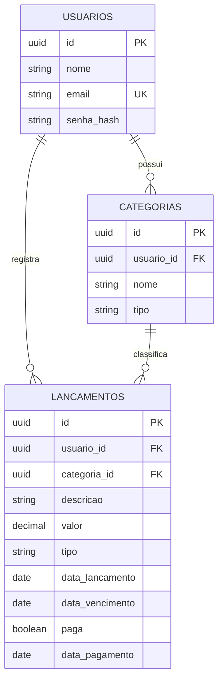

# FinanceFlow

Painel de controle financeiro pessoal com lançamentos, categorias, contas a vencer e alertas agendados.

## Stack

- **API:** Java 21, Spring Boot 4.0.9, Spring Security com JWT, Spring Data JPA, PostgreSQL, Flyway
- **Web:** Angular 21 (standalone), TypeScript, SCSS
- **Infra local:** Docker Compose

## Modelo de dados



## Testes

```bash
cd api
./mvnw verify
```

Os testes de persistência sobem um PostgreSQL real via Testcontainers, então o Docker precisa estar ativo.

## Status

Em desenvolvimento.
